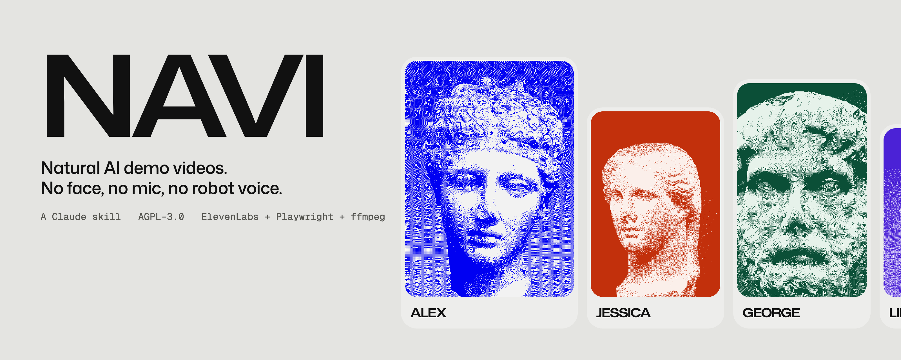
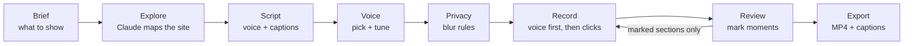
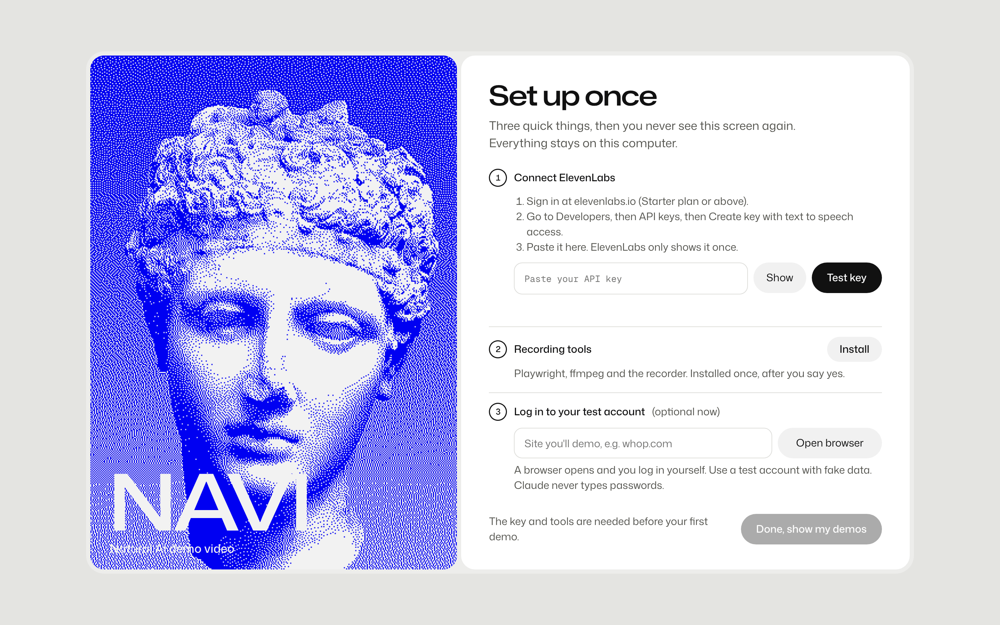
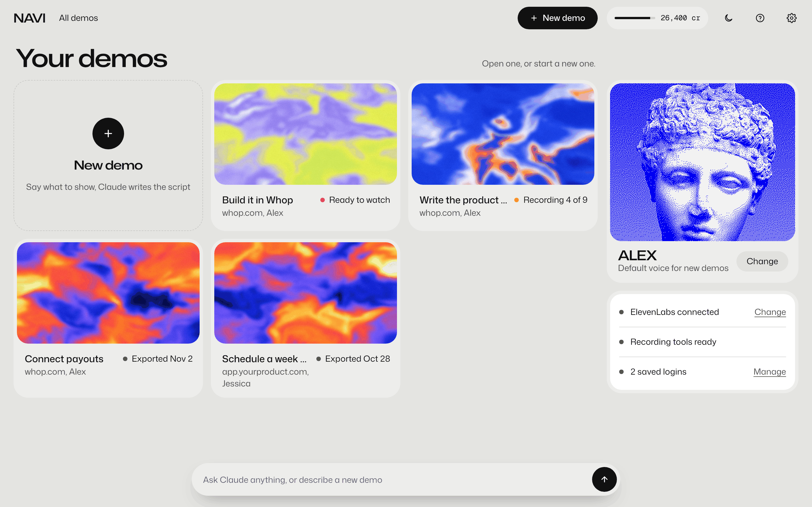
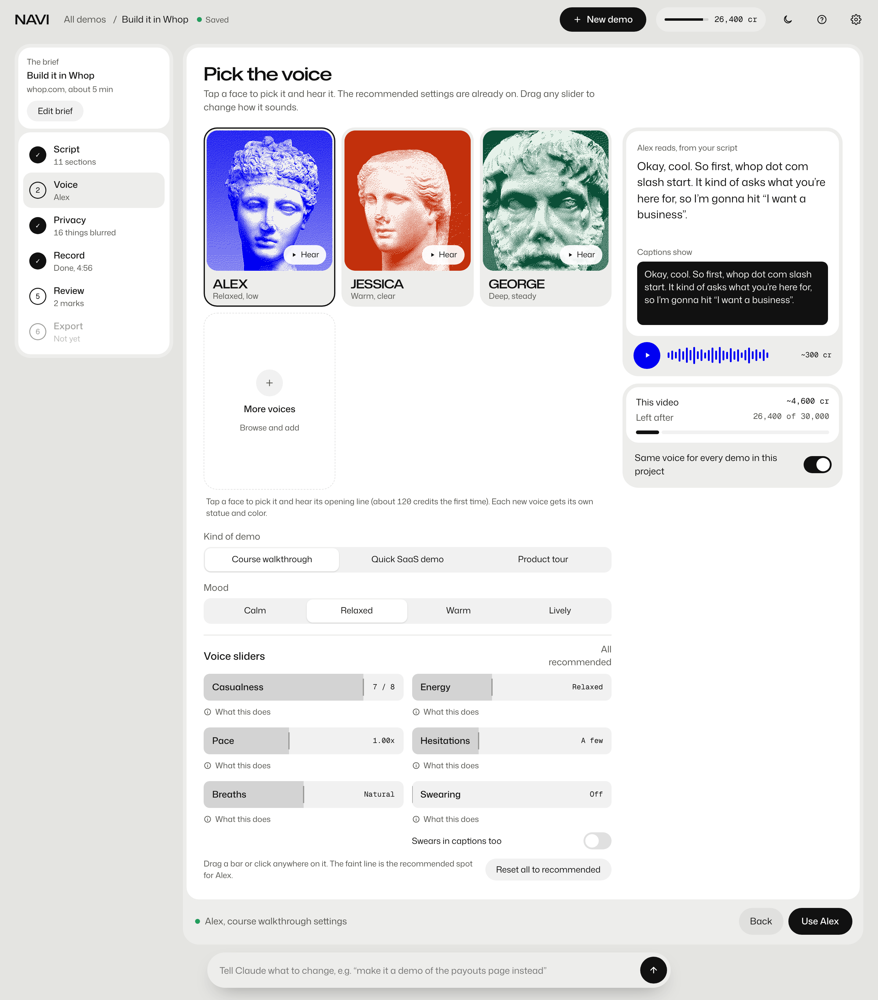
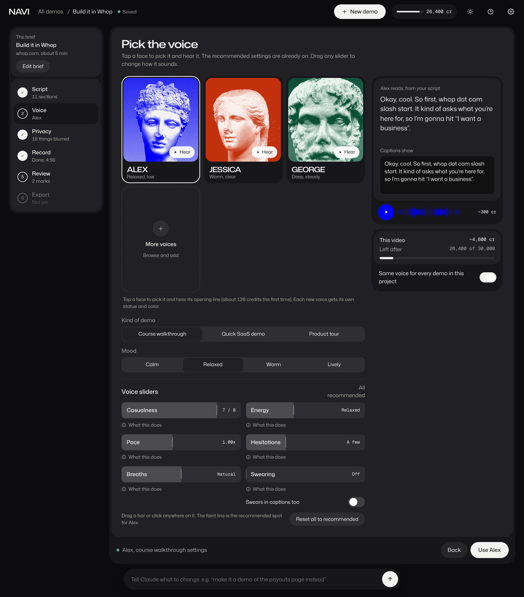
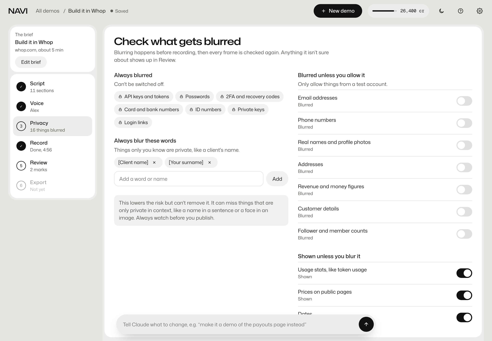
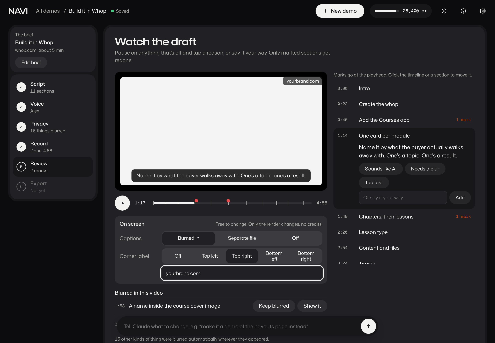
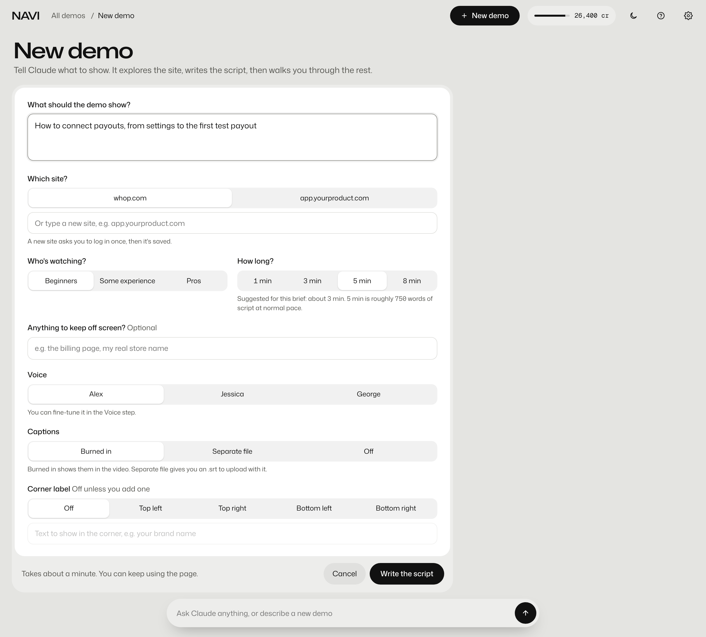

<p align="center">
  
</p>

<p align="center">
  <a href="LICENSE"></a>
  
  
  
  
  
</p>

# NAVI

**Natural AI demo videos.** Tell Claude what to show. NAVI explores the site, writes a script that sounds like a person talking, voices it with a natural AI voice, records the browser doing every click in time with the voice, blurs anything private, and hands you an MP4 with captions.

No face on camera. No microphone. No robot voice.

<p align="center">
  
</p>

> [!NOTE]
> **NAVI works, and it's early.** The engine runs for real: one voice take per section, word timings, live recording to the voice, blur before and after recording, render and export, and batches that run by themselves. The local app is wired to it. It runs on a Mac (tested on Apple silicon). See the [roadmap](#roadmap) for what's still to come.

---

## Contents

- [Why NAVI](#why-navi)
- [What it does](#what-it-does)
- [How it works](#how-it-works)
- [Why it sounds human](#why-it-sounds-human)
- [Where the rules come from](#where-the-rules-come-from)
- [Screens](#screens)
- [Install](#install)
- [Use it](#use-it)
- [Voice sliders](#voice-sliders)
- [Captions and labels](#captions-and-labels)
- [Privacy](#privacy)
- [Costs](#costs)
- [Project layout](#project-layout)
- [Roadmap](#roadmap)
- [FAQ](#faq)
- [Credits](#credits)
- [License](#license)

---

## Why NAVI

Demo videos, walkthroughs and course lessons usually mean one of three things:

1. **Your face and your voice**, recorded again every time the product changes.
2. **A text-to-speech voice** that sounds read off a page, with clicks that drift out of time.
3. **A paid video tool** that still needs you to record the screen yourself.

NAVI is a fourth option. It treats the voice like a real person talking: one relaxed take per section, small restarts and reactions where the screen earns them, and clicks timed to the exact word they belong to. The browser does the clicking. You watch the draft, mark anything that's off, and only those parts get redone.

## What it does

| | |
|---|---|
| **Set up once** | Paste your ElevenLabs key, NAVI installs its recording tools (after asking), and you log in once per account (your owner login). Next time you go straight to your demos. |
| **Doesn't take over your screen** | NAVI films in its own invisible browser, with your saved logins, while you keep working. No window pops up, nothing steals your mouse or keyboard. The only window it ever opens is a login, and only when you click "Log in". |
| **Brief in plain words** | "Make a demo of how to connect payouts, for complete beginners, about 3 minutes." Or change direction mid-way from the chat bar: "actually, make it a demo of the settings page instead." |
| **Two scripts, side by side** | What the voice says (with natural ums, restarts and reactions) and what the captions show (clean). You approve both. |
| **Voices with faces** | Each voice gets its own public-domain marble statue and color. Tap a face to hear it. Add more from your ElevenLabs library. |
| **Six safe sliders** | Casualness, energy, pace, hesitations, breaths and swearing, each locked to a narrow range so nothing tips into AI slop, with a recommended mark per voice. |
| **Records on its own** | The browser runs every step while the voice talks. Walk away; Claude tells you when the draft is ready. |
| **Safe in your real account** | Each video picks the right login (a buyer's view, your test business, or your real business only when the video is about it). NAVI can open and film any page, payouts and API keys included, with every number and key on them blurred. What it can't do is act: withdrawing, transfers, refunds, bank details, API keys, team changes and deleting are stopped in code before they leave the browser, and in a real business so is any change you didn't ask for. |
| **Privacy first** | Keys, passwords and card numbers are always blurred. Emails, names and money are blurred unless you allow them. Every frame is checked again after recording. |
| **Review like an editor** | A player with section ticks. Mark a moment ("sounds like AI", "needs a blur", "too fast") or type a note. Only marked sections are redone, with the cost shown first. |
| **Learns your taste** | Your marks tune each voice's defaults for next time. |
| **Your call on screen** | Captions burned in, as a separate file, or off. No watermark or corner label unless you add one (your brand name, top right, say). Change both in Review for free; only the render changes. |
| **Export** | MP4, captions (.srt) and a transcript, plus an optional 720p preview. |
| **Your data, your call** | Everything stays on your computer. Remove the key, forget logins, reset settings or delete everything from one page. |

## How it works



1. **Brief.** You say what the video should show, who it's for and how long it should be. Optional: words that must never appear on screen.
2. **Explore.** Claude opens the site in a browser (you log in to a test account yourself; Claude never types passwords) and maps the screens and steps.
3. **Script.** Claude writes two versions per section: the talking version for the voice and a clean version for captions.
4. **Voice.** You pick a voice and adjust the sliders. The text preview updates for free; an audio sample costs a few credits.
5. **Privacy.** NAVI blurs sensitive things in the page before recording, using the three privacy tiers below.
6. **Record.** Each section's voice is generated as **one continuous take**. NAVI gets word-level timestamps for that take and schedules every click, scroll and type action at the right word. The browser is recorded live while the voice plays, so the footage is never retimed afterwards; slow page loads fall between sections, and the voice never pauses.
7. **Review.** You watch the draft in the local app and mark anything that's off.
8. **Export.** NAVI renders the final MP4 with captions and saves it to your folder.

The heavy lifting is done by scripts (Playwright, ffmpeg, a local speech-timing model), so a run uses very little Claude usage. Claude writes the script, makes decisions and handles your fixes. Engine details: [`docs/engine.md`](docs/engine.md).

## Why it sounds human

These rules came out of five rounds of listening tests on real walkthroughs:

- **The text matters more than the voice.** A separate talking script, written the way people actually explain things, beats any voice setting.
- **One take per section.** Stitching sentence-sized clips kills breaths, mouth sounds and flow. NAVI never splits a take at cue words.
- **The voice leads, the video follows.** The browser is recorded live to the finished voice, each click starting on its word. Nothing is held, sped up or retimed afterwards. The audio is never paused or sped up.
- **Very few fillers, only where the screen earns them.** Realism comes from pace, reactions, small restarts and opinions, not from "um" every sentence.
- **Calm beats cheerful.** Slightly higher stability and a relaxed delivery; no bright one-word lines like "There it is!".
- **No forced breaths.** Tagged breaths sound theatrical. The model's own unprompted breaths are kept, and sentence ends are never trimmed tight.
- **Normal speed.** Walkthroughs play at 1x, never sped up.

## Where the rules come from

Every rule and default in NAVI goes back to something written down in this repo.

- **Research.** [`reference/research/sources.md`](reference/research/sources.md) lists 68 papers on how people talk when they explain something: fillers, pauses, breaths, clicks, asides, examples, swearing, and how reading aloud differs from talking. 34 were read in full. For the rest the file says what was read (the abstract, or another paper's summary). Two speech corpora were used for counts only, and 20 Creative Commons screen walkthroughs on YouTube (10 casual, 10 scripted) were transcribed word for word and measured. The findings are in [`reference/research/`](reference/research). No third-party audio or transcripts are in the repo.
- **Listening rounds.** Andy listened blind, with versions labelled X/Y or A/B/C, in six rounds on 5 November 2026: voice models, stability, tags, sentence endings and the first full script. His picks and his notes, word for word, are in [`reference/listening/`](reference/listening).
- **Video drafts.** Test videos, first of a to-do app and then of Whop's dashboard and course pages, were recorded, watched and marked between 8 and 13 November. The written reviews are in [`reference/listening/`](reference/listening) and [`docs/proofs/`](docs/proofs).
- **Reviews become rules.** When a review found a problem, the fix went into a rule file ([voice](reference/voice-rules.md), [script](reference/script-writing.md), [recording](reference/recording-rules.md), [privacy](reference/privacy.md)) or a default in [`config/defaults.json`](config/defaults.json), with Andy's name, the date and the reason next to it. A change to the recording, privacy or the finished video also needs a before/after proof.

## Screens

<table>
  <tr>
    <td width="50%"><br><sub><b>Set up once.</b> Key, tools, test login. Never shown again.</sub></td>
    <td width="50%"><br><sub><b>Your demos.</b> Status at a glance, credits always in the top bar.</sub></td>
  </tr>
  <tr>
    <td><br><sub><b>Pick the voice.</b> Statue portraits, presets, sliders, live preview, cost meter.</sub></td>
    <td><br><sub><b>Dark mode.</b> Follows your system, or pick one in Settings.</sub></td>
  </tr>
  <tr>
    <td><br><sub><b>Privacy.</b> Three tiers, with a warning when you choose to show something risky.</sub></td>
    <td><br><sub><b>Review.</b> Marks pinned to the playhead; captions and corner label change for free.</sub></td>
  </tr>
  <tr>
    <td colspan="2"><br><sub><b>New demo.</b> Say what to show; choose captions and an optional corner label up front.</sub></td>
  </tr>
</table>

## Install

### What you need

- A Mac (tested on Apple silicon, macOS 15 and later)
- [Claude Code](https://docs.claude.com/en/docs/claude-code/overview) (terminal, IDE or the desktop app's Code tab)
- An [ElevenLabs](https://elevenlabs.io) account (Starter plan or above) and an API key with text to speech access
- [Node.js](https://nodejs.org) 20 or newer, and Apple's free command line tools (`xcode-select --install`, for git and Swift)

NAVI's own Python, the recorder, its browser and the word-timing model are installed for you, inside NAVI's folder, after you say yes. If [uv](https://docs.astral.sh/uv/) (which sets up that Python) isn't on your Mac yet, Claude shows you the one-line command first.

### Install with Claude Code

```bash
git clone https://github.com/4ndychu/natural-ai-demo-video.git ~/Developer/natural-ai-demo-video
cd ~/Developer/natural-ai-demo-video
claude
```

Then tell Claude **"install this"**. Claude runs the readiness check, tells you what's missing and how big it is (about 500 MB in the folder plus about 1 GB of shared downloads), and after you agree runs `scripts/setup/install.sh`. That installs everything inside this folder and links `~/.claude/skills/natural-ai-demo-video` to it, so from then on Claude Code finds NAVI in any session. You can clone it anywhere else too: the folder you clone into is where NAVI lives.

You store your ElevenLabs key yourself, never in the chat: run `sh scripts/setup/store-key.sh` in your own terminal (the paste stays hidden), or use the app's Settings. Then ask for a demo video. Before any voice is generated, NAVI shows what it will cost in credits.

### Why Claude Code, not a normal chat

NAVI records in an invisible browser on your computer, opens a login window when you click "Log in", and keeps your key in your keychain, so it has to run on your computer. When you ask for a demo, Claude Code starts a small local server and opens the NAVI app in your browser (at a `localhost` address; nothing goes online). Claude writes the script in Claude Code, and you approve it, pick the voice and review the draft in the app.

In a normal claude.ai chat the skill runs in a cloud sandbox, so Claude will tell you it needs Claude Code to record, and offer to write the script for you there instead.

### Just try the app

No install needed. Clone or download the repo and open `ui/index.html` in your browser. Every screen works with sample data.

```bash
git clone https://github.com/4ndychu/natural-ai-demo-video.git
open natural-ai-demo-video/ui/index.html        # macOS
xdg-open natural-ai-demo-video/ui/index.html    # Linux
```

Jump to a screen with `?start=home`, `?start=voice`, `?start=review` or `?start=settings`, and force a theme with `&theme=dark`.

### Your ElevenLabs key

NAVI asks for the key on first run and stores it in your Mac's Keychain. It is only ever sent to ElevenLabs. It is never written to this folder, never printed, and never committed. You can remove it any time from **Settings → Your data**.

## Use it

Ask Claude in plain words:

```text
Make a demo video of how to create a course on whop.com, for complete beginners, about 5 minutes.
```

```text
Make a 1-minute product tour of app.yourproduct.com. Keep the billing page off screen.
```

```text
Actually, make it a demo of the payouts page instead.
```

```text
Redo section 4, it sounds too cheerful.
```

## Voice sliders

Every slider is locked to a narrow range that stays human. The faint mark on each bar is the recommended spot for the voice you picked; presets for course walkthroughs, quick SaaS demos and product tours set them for you.

| Slider | Range | Lower | Higher |
|---|---|---|---|
| Casualness | 3 to 8 | Cleaner, can sound scripted | More "gonna" and "kind of" |
| Energy | Very calm to Upbeat | Steady, can go flat | Livelier, can sound overexcited |
| Pace | 0.94x to 1.08x | Easy to follow, can drag | Snappy, can rush the clicks |
| Hesitations | None to More | Can sound too perfect | Human, but too many sounds nervous |
| Breaths | Trimmed, Natural, Kept | Can sound stitched together | Only natural breaths, never forced |
| Swearing | Off, One, A few | Fine for any audience | At natural reactions, never in instructions |

Swears can be kept out of the captions with one switch.

## Captions and labels

Nothing is stamped on your video unless you ask for it.

| Setting | Options | Default |
|---|---|---|
| Captions | Burned in, separate .srt file, or off | Burned in |
| Corner label | Off, or your text in any corner | Off |

Set defaults once in Settings, override them per demo in the brief, and change them in Review before exporting. Changing them never costs credits, because only the final render changes.

## Privacy

NAVI lowers the risk of showing something private. It can't remove it. Always watch a video before you publish it.

**Layers of protection**

1. **The right login, and a guard on actions.** Each video uses the login it needs (the course's member pages for what buyers see, never the dashboard; a test business for how-tos). NAVI never types passwords, and an action guard stops withdrawals, transfers, refunds, bank and API key changes, team changes and deleting before they leave the browser.
2. **Blur before recording.** NAVI reads the page text and blurs matches before the first frame is captured.
3. **Check every frame after recording.** A text scan of the finished frames catches things inside images and screenshots.
4. **You review the list.** Everything blurred, and everything NAVI wasn't sure about, is listed with a timestamp.

**Three tiers**

| Always blurred (can't be turned off) | Blurred unless you allow it | Shown unless you blur it |
|---|---|---|
| API keys and tokens, passwords, 2FA and recovery codes, card and bank numbers, ID numbers, private keys, login links | Emails, phone numbers, real names and profile photos, addresses, revenue and money figures, customer details, follower and member counts | Usage stats, prices on public pages, dates |

Turning on money figures shows a reminder that results shown in marketing are claims you may have to back up. Showing other people's data always shows a warning. You can also add your own words to always blur, like a client's name.

## Costs

NAVI itself is free. Voice generation uses your own ElevenLabs credits, and the app always shows the cost before it spends anything.

| Action | Approximate ElevenLabs credits |
|---|---|
| Hear a voice's opening line (first time) | about 120 |
| Play a sample of your current settings | about 300 |
| Voice a 5-minute video | about 4,600 |
| Redo one marked section | about 420 |

Replays of something you've already heard are free. Figures are estimates and depend on script length.

## Project layout

```text
natural-ai-demo-video/
├── SKILL.md            How Claude runs NAVI, step by step
├── ui/                 The local app (open index.html)
│   ├── index.html
│   ├── app.js          Screens, state and sample data
│   ├── assets/         Voice statues and demo covers
│   ├── fonts/          Mona Sans, Geist Mono
│   └── vendor/         petite-vue
├── recorder/           The browser recorder (agent-screenplay + NAVI's patch) and polish/
│   └── polish/         Recordly's own renderer, pinned and unedited, for both video styles
├── scripts/            The engine: voice, timing, recording, privacy, render, batches, setup/
├── reference/          Voice, recording and privacy rules from the listening tests
├── config/
│   └── defaults.json   Slider ranges, presets, per-voice settings, each job's model
├── docs/
│   ├── engine.md       How recording, timing and rendering work
│   ├── banner.png
│   ├── demo.gif
│   └── screens/
└── LICENSE
```

## Roadmap

- [x] Voice research: listening rounds, the one-take-per-section rule, slider ranges
- [x] Privacy model: three tiers, four layers
- [x] Local app: every screen and control, light and dark mode
- [x] Engine: one continuous take per section, word timestamps, clicks scheduled to the word
- [x] Engine: pre-recording blur and post-recording frame scan
- [x] Engine: render and export (MP4, .srt, transcript, 720p preview)
- [x] Wire the local app to the engine (served locally, nothing on the web)
- [x] Keychain storage, saved logins, "Your data" controls
- [x] Batches: many videos in one go, running by themselves, with an action guard and a morning report
- [x] One-command install from a fresh clone
- [ ] Linux
- [ ] Learning from review marks
- [ ] First public example videos

## FAQ

**Does NAVI clone my voice?**
No. It uses voices from your ElevenLabs account and library. Nobody hears your real voice and nobody sees your face.

**Is anything uploaded or hosted?**
No. The app is a local page that ships with the skill. The only outside calls are to ElevenLabs for voice generation and to the site you're demoing.

**Will Claude log in for me?**
No. When you click "Log in" in Settings > Logins, a browser opens and you log in yourself. NAVI saves that session for next time (one per account, for example "owner") and checks before each batch that every one still works. You can forget any saved login.

**Can I use it for any website or app?**
Anything that runs in a browser. Desktop apps aren't supported.

**Which voices can I use?**
Any voice in your ElevenLabs account. NAVI starts you on a few tested voices; add more from the voice library inside the app.

**Why statues?**
Every voice needs a face that isn't a real person or a generated one. Public-domain marble heads from the Met's open-access collection, each in its own color, do that job.

## Credits

- **[Recordly](https://github.com/webadderallorg/Recordly)** by webadderall, AGPL-3.0. NAVI's two video styles are drawn by Recordly's own export renderer: its cursor, click, zoom, motion blur and frame code, with Recordly's own default settings. The files are copied unedited from Recordly 2.0.0-beta.1, commit [`b2b2f2b`](https://github.com/webadderallorg/Recordly/commit/b2b2f2b8bf00d7ea7d1f5364d8f1fabaf5f6e457), into [`recorder/polish/recordly/`](recorder/polish/recordly), with Recordly's licence, copyright and third-party notices (including the community cursor themes' GPL licences). Copyright (C) 2026 webadderall.
- **[agent-screenplay](https://github.com/gmpetrov/agent-screenplay)** by gmpetrov and the Screenplay contributors, MIT ([licence](recorder/agent-screenplay.LICENSE)). NAVI records the browser with it, plus a small patch.
- [pixi.js](https://pixijs.com) and [pixi-filters](https://github.com/pixijs/filters), MIT, which Recordly's renderer runs on.
- Statue portraits are halftones made from public-domain images in [The Metropolitan Museum of Art Open Access](https://www.metmuseum.org/about-the-met/policies-and-documents/open-access) collection (CC0).
- [Mona Sans](https://github.com/github/mona-sans) by GitHub and [Geist Mono](https://github.com/vercel/geist-font) by Vercel, both under the SIL Open Font License.
- [petite-vue](https://github.com/vuejs/petite-vue), MIT.
- Built with [Claude](https://claude.com), [ElevenLabs](https://elevenlabs.io), [Playwright](https://playwright.dev) and [ffmpeg](https://ffmpeg.org).

## License

NAVI is free software under the [GNU Affero General Public License v3.0](LICENSE) (AGPL-3.0). Copyright (C) 2026 Andy Chu.

NAVI includes code from Recordly (AGPL-3.0, Copyright (C) 2026 webadderall), which is why NAVI is AGPL too. If you change NAVI and let other people use it over a network, you must offer them your source code. Recordly's files keep their own notices in [`recorder/polish/recordly/`](recorder/polish/recordly). agent-screenplay's MIT notice is in [`recorder/agent-screenplay.LICENSE`](recorder/agent-screenplay.LICENSE).
