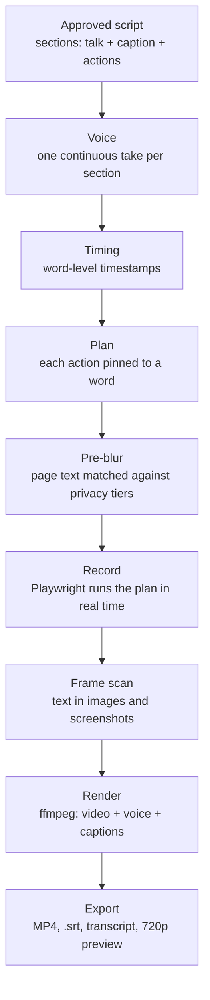

# NAVI engine

How NAVI turns an approved script into a finished video. Status: **in development**; this document is the spec the engine is being built against. The rules it must follow are in [`reference/`](../reference) and the default values in [`config/defaults.json`](../config/defaults.json).

## Pipeline



## 1. Script format

Each demo is a list of sections. Each section carries what the voice says, what the captions show, and the browser actions, with the word each action should land on.

```json
{
  "title": "Connect payouts",
  "site": "app.yourproduct.com",
  "voice": { "id": "alex", "stability": 0.7, "style": "relaxed", "pace": 1.0 },
  "sections": [
    {
      "name": "Open settings",
      "talk": "Okay, so first, settings. It's, um, it's tucked away bottom left.",
      "caption": "First, open Settings. It's at the bottom left.",
      "actions": [
        { "on": "settings", "do": "click", "target": "role=link[name='Settings']" },
        { "on": "left", "do": "highlight", "target": "nav >> text=Settings" }
      ]
    }
  ]
}
```

## 2. Voice: one take per section

- Each section's talking line is sent to ElevenLabs as **one request**, producing one continuous take.
- Takes are never split at cue words or stitched from sentences. Splitting removes the breaths, mouth sounds and momentum that make speech sound real.
- Sentence ends aren't trimmed tight. Each section ends with a short fade into room tone.
- Settings come from the voice's recommended values plus the user's sliders, clamped to the safe ranges.

## 3. Timing: word timestamps

- A local speech-recognition model (Whisper family) produces word-level timestamps for each take.
- Each action's `on` word is matched to its timestamp (fuzzy match, first occurrence after the previous action).
- The result is a schedule: `[{ t: 3.42, do: "click", target: ... }, ...]`.

## 4. Recording: the voice leads

- Each section's take is generated **before** recording. Playwright then runs the schedule live while the take plays, so every action starts at its word. The footage plays at normal speed under the voice.
- **No retiming afterwards:** no held frames, no speed-ups, no jumps. Retiming footage to fit the voice was tried and looked glitchy.
- Long waits (page loads, processing) are placed **at section boundaries**: the section's voice ends, the wait plays at real speed under room tone, and the next section starts once the page has settled.
- The voice is never paused, cut or sped up to fit the screen.
- The browser is captured at 2× with no cursor drawn. Recordly's own renderer then draws the video in the chosen style: **Casual** (Recordly's cursor and click, no zoom) or **Recordly** (also Recordly's auto-zooms and motion blur). Recordly's code is pinned and unedited ([`recorder/polish`](../recorder/polish/README.md)).
- Rules and the reasons behind them: [`reference/recording-rules.md`](../reference/recording-rules.md).

## 4a. Speed (measured, 12 Nov 2026)

Where the time went on a real 2:47 lesson in NAVI Test, and what changed:

- **One take, not two or three.** The recorder's cursor arrives on each word by itself (`landAt`), so the calibration take is gone; a second take only when the first fails the join check. See `reference/recording-rules.md` 1b.
- **No discarded draft.** The recorder used to edit its own draft video after every take (about as long as the take again); NAVI never used it. `record --take-only` skips it.
- **Capture and render apart.** `record.py --capture-only` films; `--finish` scans the frames, has Recordly draw the video and runs the join checks. In a batch (`Recorders` in `scripts/batch/batch.py`) one video is drawn while the next is voiced and timed. Drawing while the next is being filmed (`app.batch.render_while_recording`) and filming two or three at once (`app.batch.record_parallel`) are switched on only when `scripts/focus/load_check.py` shows a live take comes out the same that way; a video that creates things in a test business is always filmed alone.
- **Sites are remembered.** `scripts/explore/memory.py` keeps each exploration (notes and page data) in `$NAVI_DATA/sites/<site>/<login and view>/` for `explore.remember_days` days; the next video's explorer gets the notes and only walks what is new. `memory.py list`, `memory.py forget <site>`.
- **The explorer no longer waits 8 s a step** on apps that never go quiet: a page counts as settled when the network is quiet or nothing on it has changed for 0.9 s.
- **Rehearsal** (`scripts/record/rehearse.py`) is a new stage and costs time, but it is what stops a take failing after the voice is paid for.
- **A busy Mac** (`store.mac_load()`, `batch.py mac`): the load and the apps to quit (`app.batch.heavy_apps` when open, and any app over `heavy_cpu` % of a core; iCloud syncing named on its own) are shown on the Go screen, logged at Go and written in the report. It never stops a batch.
- **Crowded pointing** (`check_script.py`, error `crowded`): each click or hover is taken to keep the cursor busy about 1.2 s; words are timed at 0.26 s each plus 0.30 s a comma and 0.79 s a full stop (fitted on the real voice); an action predicted to land over 1 s late is an error, so the writer spreads them out and the take passes the first time.
- Every stage is timed: `batch.json` → `timings`, each recording's `report.json` → `stages`, and "Time per video" in the batch report.

## 4a2. Ready states and the community pages (13 Nov 2026)

- **Ready state:** `<demo>/prepare.json` (`url`, `steps` in the explore format, `expect`) is run headless with the seat's login and the guard after each cleanup: before every take (`record.py prepare`), before the rehearsal, and before the explorer's first run (the explorer is told how to make it again between its own runs). A failed step stops that take with the reason.
- **Community pages:** whop puts a business's apps (Courses, Chat) on its community pages (`whop.com/<slug>/`), outside the dashboard. `pages` on a business in `$NAVI_DATA/seats.json` maps them to it, so the guard treats NAVI Test's course pages as the test business and Real Biz's as Real Biz; any other page is still the owner's own account.
- **Cleanup:** `scripts/cleanup/test_products.mjs` deletes NAVI's own "NAVI test" products, then courses (each with its chapters and lessons) and chapters in the business's Courses apps; `--dry-run` lists what it would delete.

## 4b. Seats and the action guard

- **Seats** (`scripts/seats/`): named saved logins per site (`$NAVI_DATA/seats.json`, sessions in `$NAVI_DATA/logins/<site>/<seat>.json`), for example *owner* on whop.com, plus the businesses it opens. The seat picker reads the job and picks the owner on the member-facing pages (a buyer's view), owner in the test business (how-tos) or owner in a real business (only when the job names it and needs its dashboard). The script carries the pick; explore, the privacy check, every take and the cleanup use that seat's login.
- **Action guard** (`scripts/guard/guard.mjs`, site packs in `config/guard/`): Chrome's own request interception (CDP Fetch, set on the whole browser, so the cache stays on) in every browser NAVI opens (the recorder gets it through its `guard` scenario field). Every request that could change something is classified before it leaves the browser: reads and background traffic pass; withdrawing, transfers, refunds, card payments, bank/payout/billing details, API keys, team and ownership, and deleting are blocked in every seat; in a real business every other change is blocked unless the job asked for it, and unknown changes are blocked by default. A block ends the take, and the video fails with the reason (`blocked.json`). The whop.com pack comes from logged runs (`explore.mjs --learn` / `--log-writes`) and from the operations listed in whop's own scripts (`scripts/guard/catalogue.mjs`).

## 4c. Model jobs

- **One subagent per job** (`scripts/jobs/jobs.py`, prompts in `scripts/jobs/prompts/`): planning, explore, writing, checks and batch_qa each run as a headless Claude Code session (`claude -p`) on the model and effort in `config/defaults.json` → `jobs`, by full model ID. A subagent gets no MCP servers and no free shell: only the files and the NAVI scripts its job needs, and it can never prompt.
- **Lean by design** (Andy, 12 Nov 2026): a subagent loads only what its job needs. Its own short instructions replace Claude Code's defaults, it gets none of the user's settings, skills or memory, and only its few tools (planning and the line reviews none; explore Read, Write and two commands). The batch puts the job's rules (only the sections it works to, `jobs.doc`) and its files (`jobs.attach`) inside the prompt, so it reads nothing else; the explorer reads a short digest of each run (`scripts/explore/digest.py`) instead of the full `explore.json`; planning and the last check answer in a fixed JSON shape; the last check gets its frames pulled for it; an unchanged draft's line review is reused. Measured on the same to-do video: 199,000 new tokens in, 35,000 out and 1,830,000 re-read from the cache before; 103,000, 21,000 and 136,000 after.
- **Fallbacks:** when a model is unavailable (unknown, retired, no access, overloaded) the job's next `fallback` runs and the run carries a warning. Any other failure stops the job with the reason; it never quietly switches model. A headless run never falls back to a model in `headless_never_fallback_to` (Fable).
- **Warnings by date:** `warn_after` flags a model wherever the config still uses it after its date (claude-opus-4-6 after 2027-01-15).
- **The log:** every run is appended to the batch's `jobs.jsonl` (model, effort, seconds, tokens in and out, the fallback warning), including the line reviews the script tools run underneath (`scripts/script/moves.py`, through `$NAVI_JOBS_LOG`). The batch report's "Models" table and `report.jobs` / `report.warnings` on the batch come from it.
- **In a batch:** `batch.py write` runs planning once (`plan.json`), then per video explore (`explore/notes.md`), writing (three drafts, `drafts.py pick`) and checks; `batch.py run` ends with batch_qa (`qa.json`, "Before you watch" in the report). Check: `scripts/jobs/test_jobs.py` (`--live` asks each real model for one word).

## 4e. Batches that survive

- **Its own process, owned by macOS** (`scripts/batch/runner.py`): `start` writes a per-batch LaunchAgent (`~/Library/LaunchAgents/com.navi.batch.<id>.plist`: run at login, start again if it dies, the `NAVI_*` settings and `PATH` it was started with) and loads it. Nothing of the batch is a child of the app's server, of T3 Code or of Claude Code, so closing them or a session timeout doesn't touch it. One runner per batch (a lock file); a second start is a no-op.
- **Awake:** while it works (writing, voice, timing, recording) the runner holds `caffeinate -i -m -s -w <its pid>`, which ends with it. While it only waits for the user (plan pick, Go, A/B/C picks) it lets go, so a batch waiting on a pick doesn't keep the Mac up all night. A Mac on battery with the lid shut still sleeps: batches want power.
- **Resume:** every step is safe to run again. Written scripts, voiced takes (never paid for twice) and recorded videos are kept; the video that was mid-recording is recorded again. After a crash launchd starts the runner again within seconds; after a restart, at the next login (with automatic login off, that means after the user logs in). Six starts in 15 minutes without getting anywhere and it stops with `needs you` instead of looping.
- **Order of work:** `batch.write` until every video has a script or a reason; `sheet`; Go (at once with `start --go` or the "start without the Go click" setting, otherwise the batch waits in state `ready`); `batch.run`; then every A/B/C pick as it comes. The Go click and picks made while it is busy are left as small files (`go.clicked`, `blind/requests/<video>.json`) that the runner takes up between two videos, because it holds `batch.json` while it works.
- **Pause and resume:** `stop` takes the job off macOS's list and ends it (state `paused`); `resume` is `start`. `runner.json` is its heartbeat (pid, phase, what it is doing or waiting for, awake); `status` and the app's `batches[].runner` read it: `alive`, `paused`, `position {done, total, at}` and `line` ("paused at video 7 of 30").
- **A video that can't be made doesn't hold the rest:** `approve` and Go take every script that is ready; a video with no script (with the writer's reason) or with checker errors left is skipped with that reason, shown on the Go screen (`plan.skipping`) and in the report. Go is refused only when no script at all is ready.
- Check: `scripts/batch/test_runner.py` (a real LaunchAgent, killed mid-batch, paused and resumed; real recordings). A real restart of the Mac can't be run from a test: the user does it once with `scripts/batch/restart_check.py` (`docs/before-first-overnight-batch.md`).

## 4d. Blind tests inside real batches

- **Where:** `scripts/batch/blind.py`, switched by `jobs.planning.blind_test` and `jobs.writing.blind_test` (`enabled`, `arms` of `{model, effort}`, and for writing `lessons`: how many of a batch's first videos). `NAVI_NO_BLIND=1` or `batch.py new --no-blind` switches it off for work that isn't real.
- **Planning:** `batch.py write` plans the batch once per arm (`blind/plan/arm<k>.json`), shuffles them to letters and stops (`state: needs you`, "pick a plan"). `pick-plan` makes that plan the batch's `plan.json`; `write` then carries on.
- **How many:** `jobs.writing.blind_test.lessons` is 2 (Andy, 12 Nov 2026: 2, not 5, to fit the credits).
- **Writing:** each arm writes one draft of the video (`<demo>/blind/arm<k>/`), all to one style of the day and the same explore notes, each through the checker and the checks job. Two or more passing drafts make a blind lesson; the first stands in as `script.json` (seat, start page) until the pick. `batch.py run` voices each draft once (`--takes 1`: three single takes instead of two takes of one script, about 1.5 times the credits for that video; the Go screen's cost counts it), writes `<demo>/blind/<letter>.mp3`, and leaves the video waiting (`results: waiting`); the other videos carry on. `pick` copies the picked draft's script and its take into the video's folder; the next `run` times and records it with that one take, spending nothing.
- **Hidden arms:** the letter-to-arm key is `batches/<id>/blind/key.json` only. `batch.json`, `/api/state` and the media route carry letters, never models. An arm whose model is unavailable or whose draft fails is left out of that comparison with a warning; no fallback model stands in. With one draft left there is no test and it ships.
- **The record:** every pick goes to `$NAVI_DATA/blind-picks.jsonl` with what was on offer. When every pick of a batch is made, the report's "Blind tests" section says which arm each letter was and the tally.
- Check: `scripts/batch/test_blind.py` (model jobs stood in, saved takes, real recording).

## 5. Privacy

- **Before recording:** a script inside every page ([`scripts/privacy/blur.js`](../scripts/privacy/blur.js)) checks each piece of text, field, avatar and account menu as it appears, before the browser paints it, using the three tiers, the user's hide words and the preset (Strict, Standard or Test account). Matched words are blurred with the CSS Custom Highlight API, so the page's own elements are never changed and the blur follows scrolling and zoom. Fields, avatars and account menus get a CSS blur. If NAVI is about to type something private, the field is blurred from the first letter. The start page is checked with the blur before the first take (`privacy-check.png`).
- **After recording:** every distinct browser frame is read with Apple's built-in text recognition. Anything still readable that matches (text in images, canvases or screenshots) is blurred in the raw frames over the time it's on screen, before Recordly's renderer zooms anything.
- **Uncertain hits** are listed in Review with timestamps for the user to keep or show.
- This reduces risk; it can't remove it. Context-only private info (a client's company name in a sentence, a face in an image) can be missed.

## 6. Render and export

- ffmpeg combines the recorded video and the voice takes, then applies the demo's on-screen settings:
  - **Captions:** burned in, sidecar `.srt` only, or off.
  - **Corner label:** off by default; otherwise the user's text in the chosen corner. No other overlays (no watermark, no "Illustrative" tag) unless the user adds them.
  - Both are render-only, so changing them never regenerates voice or re-records.
- Outputs: 1080p MP4, `.srt` captions, a plain-text transcript, and an optional 720p preview, named after the demo title, in the folder the user names (default `~/Movies/NAVI`; never inside the skill's folder). Changing captions or the corner label only re-renders (5 to 10 s); with no burned-in text the video isn't even re-encoded.
- Captions: the clean caption text, timed to the voice by matching the meaningful words it shares with what is actually said. **A caption shows only while its own words are spoken** (from 0.1 s before its first word to 0.3 s after its last). It splits where the voice says other things for more than 1.5 s, and nothing shows while the voice says things the clean caption leaves out. At most 2 lines of 42 characters, each line on its own soft dark box, bottom centre. There are two looks: Mona Sans on slightly rounded boxes, drawn by the browser (the default, Andy's pick), or Helvetica Neue on square boxes (ffmpeg). The corner label uses the same look, smaller.
- Sped-up copy (off by default): the normal file plus `<title> (1.35x).mp4` and its `.srt`. The voice keeps its natural pitch.
- Redo only what's marked: marked sections get new takes (credits shown first) or their other saved take (free). Every other section keeps its exact take. The timing is redone and the whole video recorded again (free, one continuous take). See `scripts/render/redo.py`.
- Redos only regenerate and re-record the marked sections, then re-render.

## 7. Local app

- **Blind picks** (the batch screen): a video waiting for a pick shows "Pick A, B or C" and a Listen button; the panel has one card per version with its letter, length, a Play button (one voice at a time), the first line and "Read the script", and "Pick A". The plans get the same panel before anything is written. What each letter was appears under the list ("What you picked") once every pick in the batch is made. Sample states for the layout check: `navi.sampleBlind('lesson' | 'plan' | 'revealed' | 'paused')`.
- **Pause and resume:** "Pause recording" stops the batch's background job; the screen then says "Paused at video 7 of 30. Resume?" with "Resume recording" (also on the Home card).
- **Settings › Models:** a read-only list of each job's model and effort, with the model that takes over if it is unavailable.
- Checks: `node ui/tests/layout-check.js` (every screen, width and theme) and `ui/tests/pick-live-check.js` (the pick screen, pause and Settings against the real engine).

- The app in `ui/` is served from the user's computer when the skill runs; nothing is deployed to the web.
- Setup state lives in a local settings folder; the key lives in the system keychain.
- Review marks are saved with the settings that produced them, so each voice's recommended values improve over time.
- The app and batch engine: `scripts/app/` (local server on this Mac, "wait for the app", real state, Keychain/logins/"Your data") and `scripts/batch/` (list in, approve all, record in a row, pause on low credits, review queue, export + list file). The interface for the app: [`docs/app-api.md`](app-api.md).
