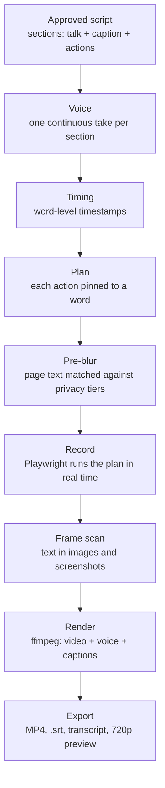

# NAVI engine

How NAVI turns an approved script into a finished video. Status: **in development**; this document is the spec the engine is being built against.

## Pipeline



## 1. Script format

Each demo is a list of sections. Each section carries what the voice says, what the captions show, and the browser actions, with the word each action should land on.

```json
{
  "title": "Connect payouts",
  "site": "app.yourproduct.com",
  "voice": { "id": "alex", "stability": 0.7, "style": "relaxed", "pace": 1.0 },
  "sections": [
    {
      "name": "Open settings",
      "talk": "Okay, so first, settings. It's, um, it's tucked away bottom left.",
      "caption": "First, open Settings. It's at the bottom left.",
      "actions": [
        { "on": "settings", "do": "click", "target": "role=link[name='Settings']" },
        { "on": "left", "do": "highlight", "target": "nav >> text=Settings" }
      ]
    }
  ]
}
```

## 2. Voice: one take per section

- Each section's talking line is sent to ElevenLabs as **one request**, producing one continuous take.
- Takes are never split at cue words or stitched from sentences. Splitting removes the breaths, mouth sounds and momentum that make speech sound real.
- Sentence ends aren't trimmed tight. Each section ends with a short fade into room tone.
- Settings come from the voice's recommended values plus the user's sliders, clamped to the safe ranges.

## 3. Timing: word timestamps

- A local speech-recognition model (Whisper family) produces word-level timestamps for each take.
- Each action's `on` word is matched to its timestamp (fuzzy match, first occurrence after the previous action).
- The result is a schedule: `[{ t: 3.42, do: "click", target: ... }, ...]`.

## 4. Recording: the voice leads

- Playwright runs the schedule against the real clock while the take plays (or against a virtual clock synced to it).
- If an action finishes early, the next one waits for its word.
- If an action runs long (a slow page load), the video **holds the last frame** for the gap instead of pausing the voice. The hold is cut or smoothed in the render.
- The cursor moves along eased paths, and clicks get a short zoom so viewers can follow.

## 5. Privacy

- **Before recording:** NAVI reads the page's text and attributes and blurs matches (CSS filter on the matched elements) using the three tiers and the user's hide words. Avatars and profile menus are blurred by default.
- **After recording:** sampled frames are scanned for text (OCR) to catch anything inside images, canvases or screenshots. Hits are blurred over their time range.
- **Uncertain hits** are listed in Review with timestamps for the user to keep or show.
- This reduces risk; it can't remove it. Context-only private info (a client's company name in a sentence, a face in an image) can be missed.

## 6. Render and export

- ffmpeg combines the recorded video and the voice takes, then applies the demo's on-screen settings:
  - **Captions:** burned in, sidecar `.srt` only, or off.
  - **Corner label:** off by default; otherwise the user's text in the chosen corner. No other overlays (no watermark, no "Illustrative" tag) unless the user adds them.
  - Both are render-only, so changing them never regenerates voice or re-records.
- Outputs: 1080p MP4, `.srt` captions, a plain-text transcript, and an optional 720p preview.
- Redos only regenerate and re-record the marked sections, then re-render.

## 7. Local app

- The app in `ui/` is served from the user's computer when the skill runs; nothing is deployed to the web.
- Setup state lives in a local settings folder; the key lives in the system keychain.
- Review marks are saved with the settings that produced them, so each voice's recommended values improve over time.
